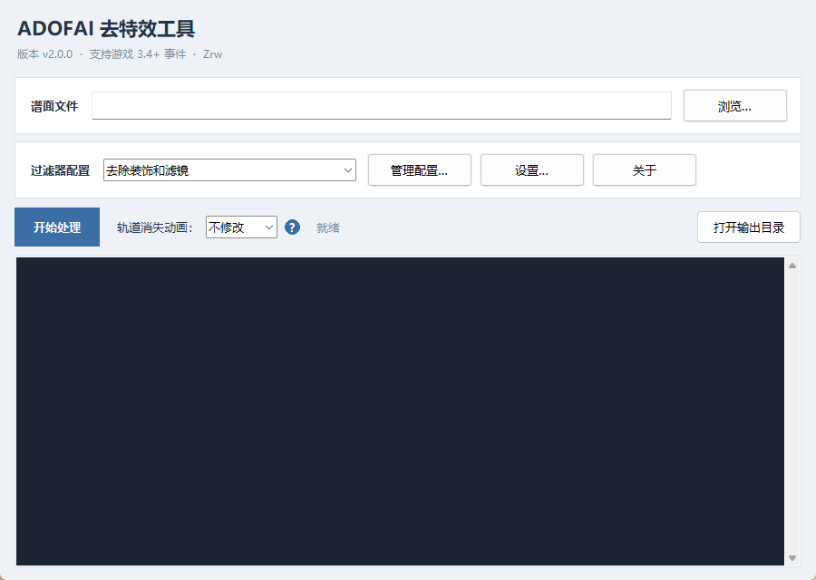
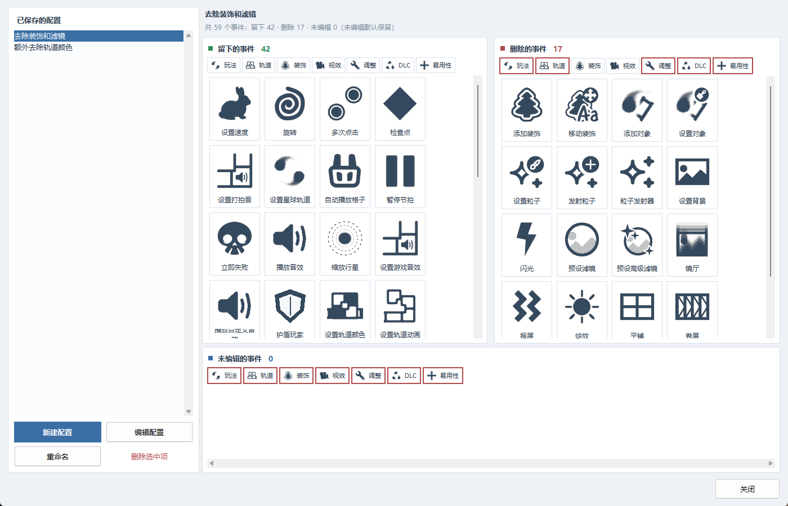
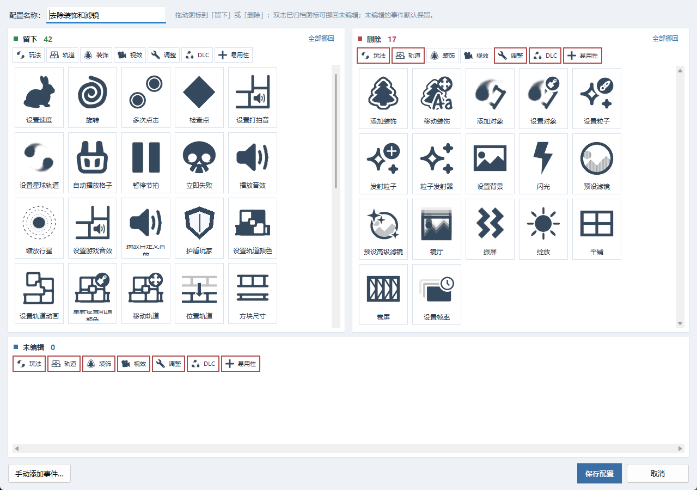
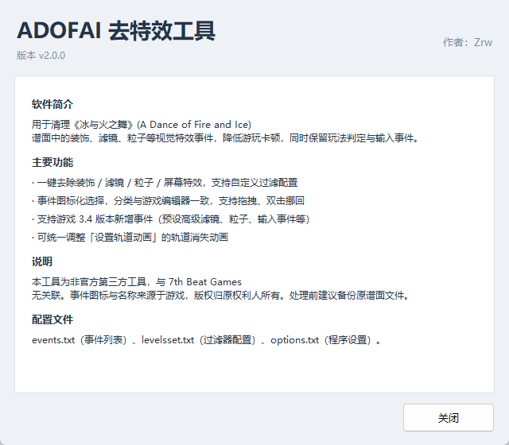
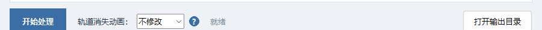

# ADOFAI 去特效工具 · ADOFAI De-Effect Tool

> 一键清理《冰与火之舞》谱面中的装饰、滤镜、粒子等视觉特效，降低游玩卡顿，同时保留玩法判定与输入事件。

**版本：v2.0.0** ｜ **作者：Zrw** ｜ **平台：Windows 10 / 11 64 位** ｜ **免费、非官方工具**

[下载](#下载) · [功能](#功能) · [截图](#截图) · [实测数据](#实测数据) · [快速开始](#快速开始) · [从源码构建](#从源码构建) · [常见问题](#常见问题)

> 本工具为非官方第三方工具，与 7th Beat Games 无关联。事件图标与名称来源于游戏，版权归原权利人所有。

---

## 简介

很多 ADOFAI 谱面为了视觉效果堆叠了大量装饰、滤镜、粒子和屏幕特效事件，
在配置一般的电脑上容易掉帧、卡顿。手动删又费时，还容易误删玩法事件。

**ADOFAI 去特效工具** 可以按配置一键过滤这类视觉事件，
只删除你选中的特效，保留判定、输入和轨道逻辑，并生成一份新的谱面文件（原文件不动）。

- 中文图形界面，事件图标与分类顺序和游戏编辑器一致
- 支持游戏 3.4 新增的 15 个事件
- 支持自定义过滤器配置，内置两套常用配置
- 支持统一调整「设置轨道动画」的轨道消失动画

---

## 下载

前往本仓库的 [Releases](../../releases/latest) 页面下载：

| 文件 | 说明 |
|---|---|
| `ADOFAI_去特效工具_v2.0.0_安装程序.exe` | 安装版：创建桌面/开始菜单快捷方式，可在系统「已安装的应用」中卸载 |
| `ADOFAI_去特效工具_v2.0.0_绿色版.zip` | 绿色版：解压到任意目录，双击 `UI.exe` 即可使用 |

解压/安装后请保持 `UI.exe`、`level.exe`、`events.txt`、`levelsset.txt`、`options.txt` 在同一目录。

---

## 功能

- **一键去特效**：选择谱面 → 选择过滤器配置 → 开始处理，自动生成 `原名_配置名.adofai`
- **内置两套配置**
  - 去除装饰和滤镜
  - 额外去除轨道颜色
- **过滤器配置编辑器**
  - 三栏「留下 / 删除 / 未编辑」，图标化拖拽编辑
  - 分类与游戏编辑器一致：玩法 / 轨道 / 装饰 / 视效 / 调整 / DLC / 易用性
  - 双击图标挪回未编辑，一键「全部挪回」
  - 某分类被全部分完时按钮显示红框提示
  - 支持手动添加新版本事件
- **支持游戏 3.4 新事件**：预设高级滤镜 `SetFilterAdvanced`、粒子系列、输入事件、游戏音效、立即失败、护盾玩家、设置格子图标等 15 个事件
- **轨道消失动画统一设置**：配置的「留下」中有 `AnimateTrack` 时，可把谱面里已开启的轨道消失动画统一改为 **无 / 收缩 / 暗淡**
- **人性化细节**：处理完成可直接打开输出目录、中英文事件名切换、处理完自动关闭、窗口位置记忆
- **安装包 / 绿色版** 两种分发形式，带卸载程序

---

## 截图

| 主界面 | 过滤器配置管理 |
|---|---|
|  |  |

| 图标化编辑配置 | 关于 |
|---|---|
|  |  |

轨道消失动画设置：



---

## 实测数据

以下为使用「去除装饰和滤镜」配置处理两张谱面的结果（事件数量与文件大小，不代表具体帧数）：

| 谱面 | 事件数 | 视觉特效事件 | 文件大小 |
|---|---|---|---|
| deleted | 2726 → 1197（移除 1529） | 1872 → 343（-82%） | 700KB → 218KB（-69%） |
| PLUM MEGAMIX 2 | 3783 → 3413（移除 370） | 662 → 292 | 533KB → 442KB |

`deleted` 中被移除最多的事件：高级滤镜 392、预设滤镜 393、装饰移动 306、绽放 Bloom 219、闪光 Flash 137。

---

## 快速开始

1. 打开 `UI.exe`
2. 点击「浏览…」选择 `.adofai` 谱面文件
3. 在「过滤器配置」中选择配置（可点「管理配置…」新建/修改）
4. 点击「开始处理」，确认后等待完成
5. 原谱面同目录会生成 `原名_配置名.adofai`，用它替换原谱面即可

> 处理前建议备份原谱面。原文件不会被修改。

### 过滤器配置

- 三栏：上左「留下」、上右「删除」、下方「未编辑」
- 拖动图标在栏间移动；双击「留下/删除」中的图标可挪回未编辑
- 未编辑的事件默认保留；全部事件都分好时按「留下」名单（白名单）处理，否则按「删除」名单（黑名单）处理
- 点分类按钮会高亮该类事件并自动滚动定位；某分类被全部分完时按钮显示红框

仓库内提供了一份内置配置示例：[docs/示例配置_levelsset.txt](docs/示例配置_levelsset.txt)
（程序实际读取的 `levelsset.txt` 为 GBK 编码，示例仅用于查看结构）。

### 轨道消失动画

当配置的「留下」里包含「设置轨道动画」(`AnimateTrack`) 时，主界面可设置：

- **不修改**（默认）
- **无** → `None`
- **收缩** → `Shrink`
- **暗淡** → `Fade`

只会修改「已开启轨道消失动画」的事件；原本为 `None` 或没有该字段的事件保持不动，
其它字段（出现动画、提前/延后节拍等）不受影响。

---

## 目录结构

```
.
├─ src/                  源码
│  ├─ UI.py              主程序
│  ├─ installer/         安装程序与卸载程序源码
│  ├─ icons/             事件图标
│  ├─ categories/        分类图标
│  ├─ categories.json    事件分类配置
│  ├─ app.ico            程序图标
│  └─ version_info.txt   Windows 版本信息
├─ docs/                 文档与截图
├─ scripts/              构建 / 上传脚本
└─ .github/workflows/    GitHub Actions 自动构建
```

---

## 从源码构建

需要 Python 3.10+（推荐 3.12）和 Windows。

```powershell
pip install pyinstaller pillow

pyinstaller --noconfirm --onefile --windowed --name UI `
  --icon src/app.ico --version-file src/version_info.txt `
  --add-data "src/icons;icons" `
  --add-data "src/categories;categories" `
  --add-data "src/categories.json;." `
  --add-data "src/app.ico;." `
  --hidden-import PIL._tkinter_finder `
  src/UI.py
```

生成的程序在 `dist/UI.exe`，需要与 `level.exe`、`events.txt`、`levelsset.txt`、`options.txt` 放在一起运行。

安装程序构建见 `src/installer/`，依赖 `pylnk3`（创建快捷方式）。仓库的 GitHub Actions
会在每次推送时自动构建 `UI.exe` 并上传为 Artifact。

---

## 常见问题

**Q：处理后游戏里没有变化？**
确认使用的是生成文件 `原名_配置名.adofai`，并用它替换原谱面后再游玩。

**Q：界面异常 / 窗口跑到屏幕外？**
删除程序目录下的 `ui_state.json` 后重新打开。

**Q：杀毒软件报毒 / SmartScreen 拦截？**
程序使用 PyInstaller 打包，未购买代码签名证书，可能被误报。请添加信任；
从本仓库 Releases 下载以确认来源。

**Q：找不到输出文件？**
确认谱面所在目录可写，且 `level.exe` 与 `UI.exe` 在同一目录。

**Q：会修改原谱面吗？**
不会。处理结果写入新文件，原文件保持不变。

---

## 更新日志

见 [CHANGELOG.md](CHANGELOG.md)。

---

## 许可与声明

- 本仓库中由作者编写的源码采用 [MIT License](LICENSE)
- `level.exe`、游戏事件图标与名称等第三方资源的版权归各自权利人所有，
  本项目仅作整合分发；详见 [THIRD_PARTY_NOTICES.md](THIRD_PARTY_NOTICES.md)
- 本项目为非官方工具，与 7th Beat Games 无关联；请尊重谱面作者与游戏版权

如果这个工具帮到了你，欢迎 Star ⭐ 或分享给需要的玩家。
